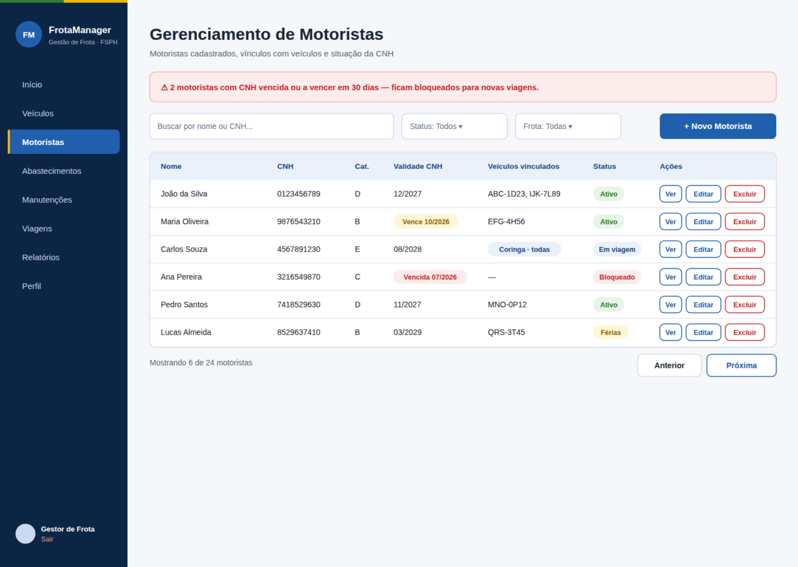
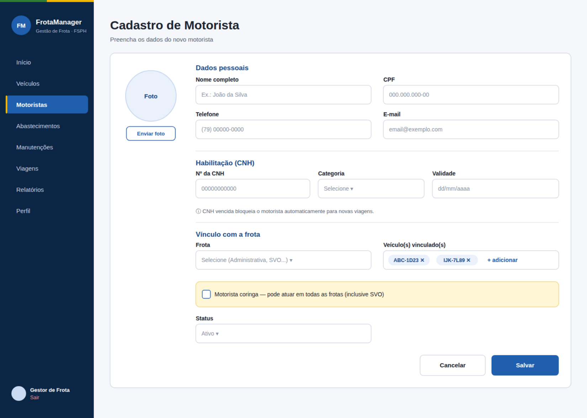
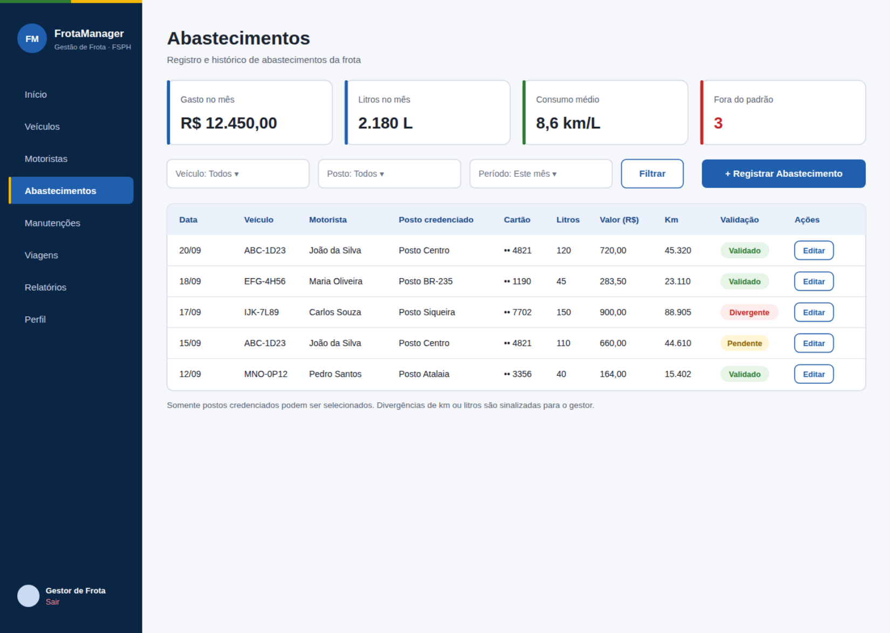
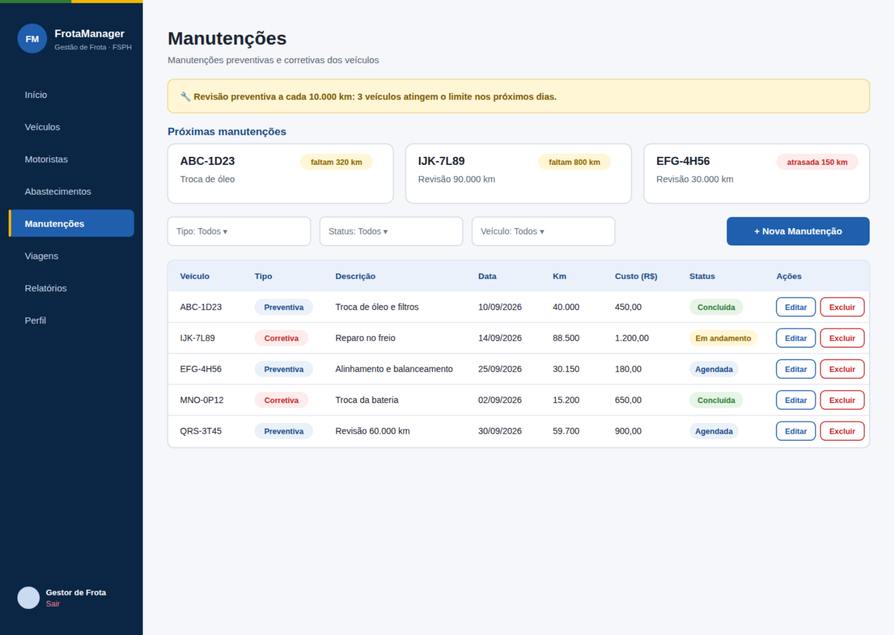
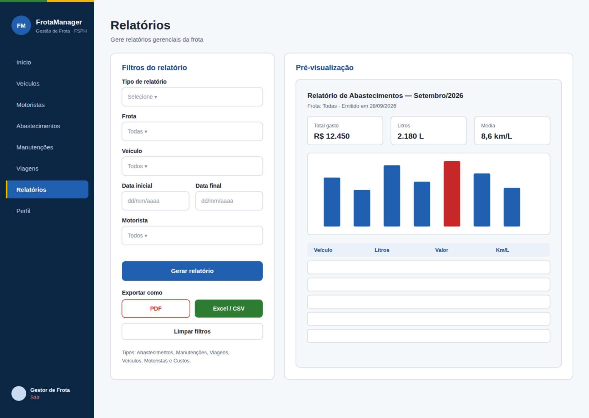

# FrotaManager – Wireframes do Sistema de Gestão de Frotas

Wireframes que fiz para o **FrotaManager**, sistema de gestão de frotas desenvolvido em grupo (Squad 20) no programa de Residência da Universidade Tiradentes (Unit), a partir de um desafio proposto pela FSPH.

O sistema centraliza o controle de veículos, motoristas, abastecimentos, manutenções, viagens e relatórios da frota. Repositório do grupo: [Squad20_Residencia-III](https://github.com/Levi-Fabricio/Squad20_Residencia-III).

## Minha parte

Fiquei responsável pelas telas abaixo. Os campos e as regras de cada tela vieram dos requisitos do backlog do projeto, e o visual segue a paleta da instituição e o padrão de layout que o grupo já usava.

| Tela | O que mostra |
| --- | --- |
| Gerenciamento de Motoristas | Lista de motoristas, validade da CNH, veículos vinculados e status; alerta de CNH vencida |
| Cadastro de Motorista | Dados pessoais, habilitação, vínculo com a frota e opção de motorista coringa |
| Abastecimentos | Indicadores do mês, histórico por veículo e validação de abastecimentos fora do padrão |
| Manutenções | Próximas revisões preventivas por quilometragem e histórico de manutenções |
| Relatórios | Filtros, pré-visualização e exportação em PDF ou Excel/CSV |

Todos os dados que aparecem nas telas são fictícios.

## Telas

### Gerenciamento de Motoristas

### Cadastro de Motorista

### Abastecimentos

### Manutenções

### Relatórios

## Decisões de design

- **Barra lateral fixa** em todas as telas, com a seção atual destacada, para o usuário saber onde está.
- **Tabelas com filtros no topo** e o botão de ação principal à direita, padrão de sistemas de gestão.
- **Cores com significado:** azul como cor principal; vermelho para alertas e ações de risco (excluir, CNH vencida); verde e amarelo para status bons e avisos.

## Ferramentas

Figma (organização e ajustes das telas com o grupo) e geração das telas em SVG com apoio de IA (Claude), a partir dos requisitos que levantei no backlog. Cada versão foi revisada com o líder do grupo antes de entrar no Figma.

O PDF com todas as telas está em [`telas/telas-frotamanager.pdf`](telas/telas-frotamanager.pdf).
